# OllaCercana — Frontend (documentación)

Este repositorio contiene únicamente documentación del frontend: modelo de flujo de pantallas, prototipo, pantallas explicadas y manual de identidad. Aún no incluye código.

## Índice

1. [Prototipo](#1-prototipo)
2. [Modelo de flujo de pantallas](#2-modelo-de-flujo-de-pantallas)
3. [Pantallas por funcionalidad](#3-pantallas-por-funcionalidad)
   - [3.1 Inicio y cocina de la abuelita](#31-inicio-y-cocina-de-la-abuelita)
   - [3.2 Ending page](#32-ending-page)
   - [3.3 Registro e inicio de sesión](#33-registro-e-inicio-de-sesión)
   - [3.4 Menú de platos El Libretón](#34-menú-de-platos-el-libretón)
   - [3.5 Mapa de cocineras cercanas](#35-mapa-de-cocineras-cercanas)
   - [3.6 Directorio y perfil público de cocinera](#36-directorio-y-perfil-público-de-cocinera)
   - [3.7 Reservar porción y confirmar pedido](#37-reservar-porción-y-confirmar-pedido)
   - [3.8 Mis pedidos y chat](#38-mis-pedidos-y-chat)
   - [3.9 Calificar y reportar](#39-calificar-y-reportar)
   - [3.10 Modo Cocinera](#310-modo-cocinera)
   - [3.11 Perfil](#311-perfil)
   - [3.12 Avisos](#312-avisos)
   - [3.13 Vecino Fiel](#313-vecino-fiel)
   - [3.14 Panel de moderación](#314-panel-de-moderación)
   - [3.15 Sesión expirada y acceso denegado](#315-sesión-expirada-y-acceso-denegado)
   - [3.16 Ajustes y ayuda](#316-ajustes-y-ayuda)
   - [3.17 Página no encontrada (404)](#317-página-no-encontrada-404)
4. [Manual de identidad](#4-manual-de-identidad)
   - [4.1 Marca y voz](#41-marca-y-voz)
   - [4.2 Logo](#42-logo)
   - [4.3 Paleta de colores](#43-paleta-de-colores)
   - [4.4 Tipografía](#44-tipografía)
   - [4.5 Iconografía](#45-iconografía)
   - [4.6 Componentes de interfaz](#46-componentes-de-interfaz)
   - [4.7 Fotografía y personaje](#47-fotografía-y-personaje)
5. [Estructura del repositorio](#5-estructura-del-repositorio)

---

## 1. Prototipo

🔗 [Ver prototipo](PEGAR_LINK_AQUI)

---

## 2. Modelo de flujo de pantallas


El visitante entra por **Inicio** (portada → animación → cocina de la abuelita → *ending page*), explora el **Menú** o el **Mapa de cocineras** sin sesión y, al intentar añadir o reservar, se le pide **iniciar sesión o registrarse**. Según su rol, aterriza en el **Menú** (comprador), el **Modo Cocinera** (cocinera) o el **Panel de comunidad** (administrador). El comprador envía su pedido desde **Confirmar pedido** y lo sigue en **Mis pedidos**; la cocinera gestiona las solicitudes en **Modo Cocinera**. Si la sesión vence o el rol no corresponde, se muestran **Sesión expirada** o **Acceso denegado**, que llevan de nuevo al inicio de sesión.

---

## 3. Pantallas por funcionalidad

Cada pantalla indica el **rol** que la ve y la **historia de usuario (HU)** y **feature (FEAT)** del Jira (épica `EPIC-01: OllaCercana`) a las que responde.

### 3.1 Inicio y cocina de la abuelita

| Campo | Detalle |
|---|---|
| **Ruta** | `/` |
| **Rol que la ve** | Todos (sin sesión) |
| **Responde a** | — (transversal, puerta de entrada) |

**Happy path.** Portada con la casa del barrio, el logo y el eslogan «Comida casera a un paso de tu puerta.». El botón **«Explora la cocina y sus accesos»** (o deslizar hacia abajo) activa la animación de entrar a la casa y muestra la cocina de la abuelita, la mascota de la marca, que lleva a la *ending page* (sección 3.2). El botón flotante **«¿Te ayudo?»** está disponible en todas las pantallas.

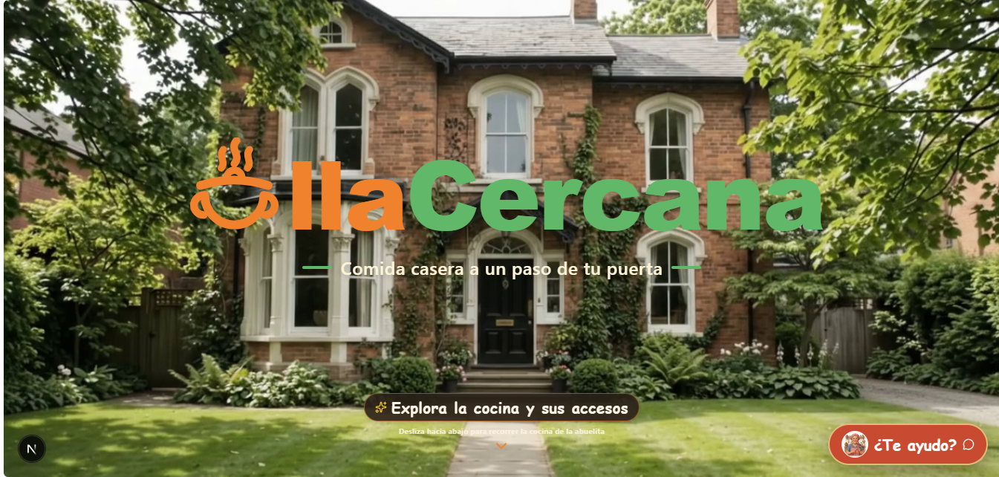

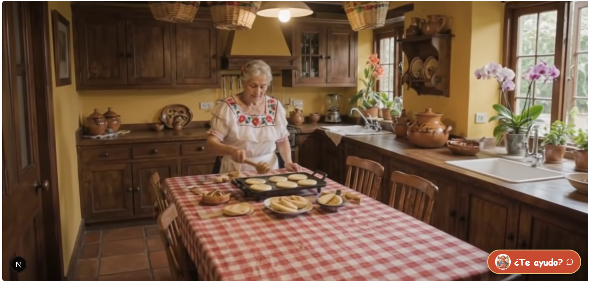

**Estado de error / vacío.** Si la ruta no existe se muestra la pantalla 404 (ver 3.17).

---

### 3.2 Ending page

| Campo | Detalle |
|---|---|
| **Ruta** | `/` (sección final, tras la animación) |
| **Rol que la ve** | Todos (sin sesión); la guía cambia según el rol elegido |
| **Responde a** | HU-11, HU-14, HU-21 (contenido informativo) |

**Happy path.** Al terminar la animación se llega al final de la experiencia, que reúne cuatro bloques:

1. **Carrusel «Visor espacial»** («Lo cercano también alimenta»): pestañas Mapa Cercano, Plato Teaser, La Abuelita, Modo Cocinera y Vecino Comensal, con tarjetas como «La Abuelita te da la bienvenida» (0 % comisiones, *Descubrir El Libretón*), un plato de muestra con **Apartar esta porción**, *Explorar Mapa en Vivo*, *Conocer Modo Cocinera* y *Ver Mis Reservas*.
2. **Por qué OllaCercana:** Sello Olla Verde, reseñas del barrio, economía del barrio (ahorro frente a domicilios de apps tradicionales) y confianza vecinal (vecinas verificadas, pago directo al recibir, sin comisiones abusivas).
3. **«¿Cómo se vive OllaCercana?»:** guía con selector **Como Comprador / Como Cocinera**, cada uno con tres pasos y un botón de acceso:
   - Comprador: *Explorar el Menú* → Menú (3.4), *Abrir Mapa Cercano* → Mapa (3.5), *Ver Mis Reservas* → Mis pedidos (3.8).
   - Cocinera: *Publicar un Plato*, *Gestionar Reservas* y *Mi Perfil de Cocinera* → Modo Cocinera y Perfil (3.10).
4. **Centro de Ayuda:** preguntas frecuentes (pago, entrega, qué pasa si una porción no se confirma en 10 minutos, vender sin ser restaurante, frescura), botón **Hablar con la Abuelita** → Ayuda (3.16) y **Volver a la cocina de la abuelita**.

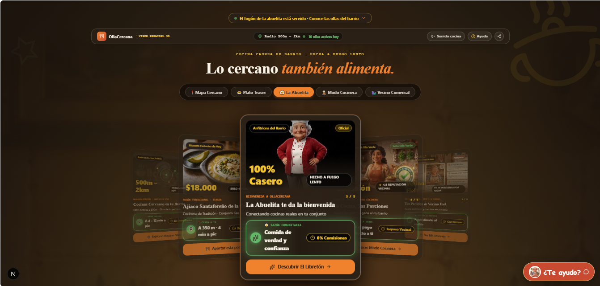

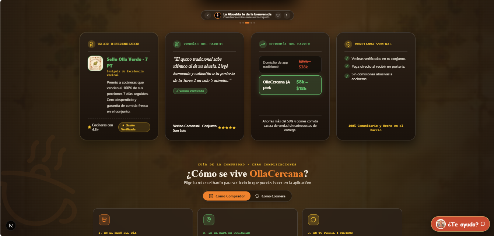

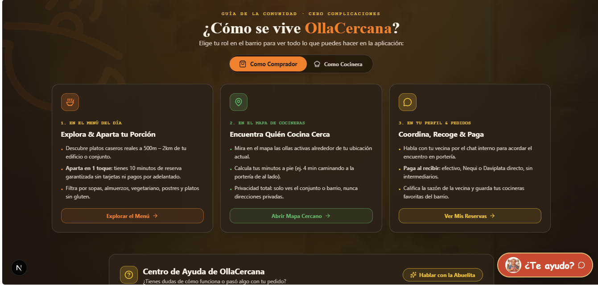

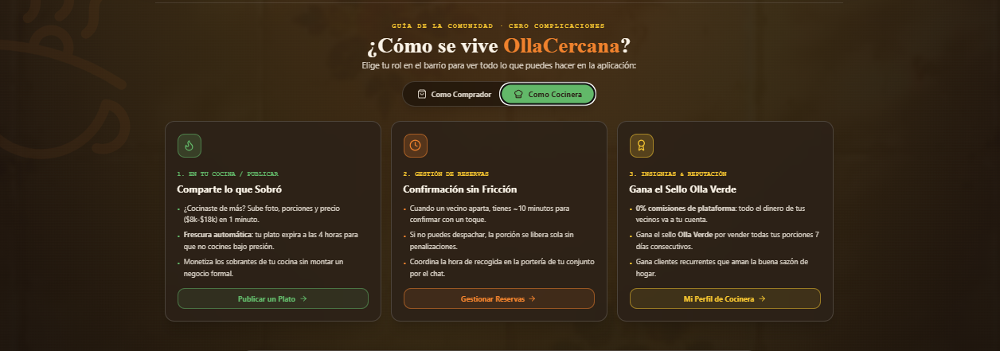

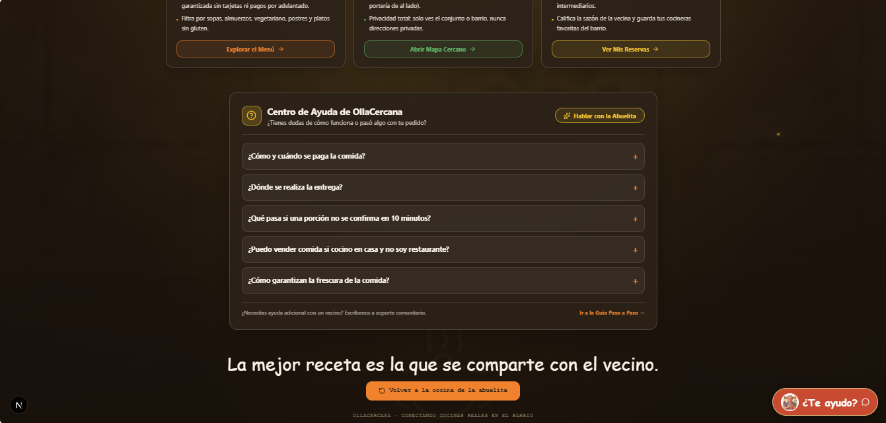

**Estado de error / vacío.** Si un visitante sin sesión pulsa **Apartar porción**, aparece el aviso «¡Estás a un paso de tu comida!» con **Iniciar Sesión** y **Crear Cuenta de Vecino**, recordando que la porción se guarda 10 minutos y que el pago se hace al recibir en portería.

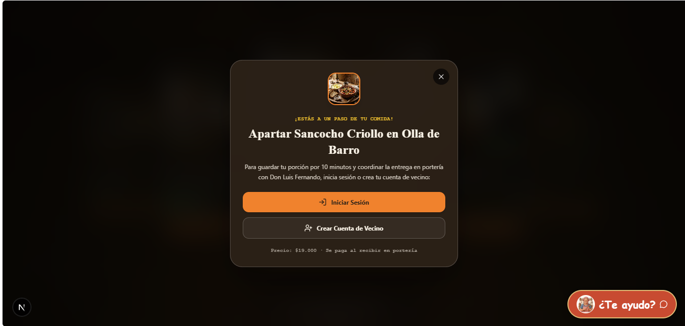

---

### 3.3 Registro e inicio de sesión

| Campo | Detalle |
|---|---|
| **Ruta** | `/cuenta`, `/cuenta/registro` |
| **Rol que la ve** | Todos (comprador, cocinera, admin) |
| **Responde a** | HU-01, HU-02 · FEAT-04 |

**Happy path.** El usuario se registra con nombre, correo, celular, contraseña y rol (comprador o cocinera) y entra a su espacio: comprador → Menú, cocinera → Modo Cocinera, admin → Panel de comunidad. En el login elige su rol y entra con correo o celular.

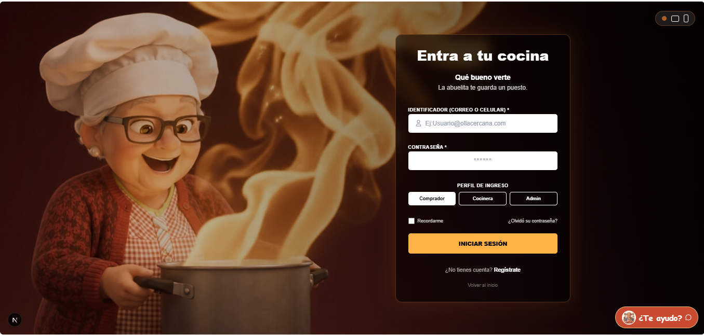

**Estado de error / vacío.** Mensajes de error: «El nombre es obligatorio», correo o celular inválido (celular de 10 dígitos que empieza por 3), contraseña sin mayúscula/minúscula/número, contraseñas que no coinciden, términos sin aceptar, correo o celular ya registrado, «El usuario no existe» y «La contraseña no coincide».

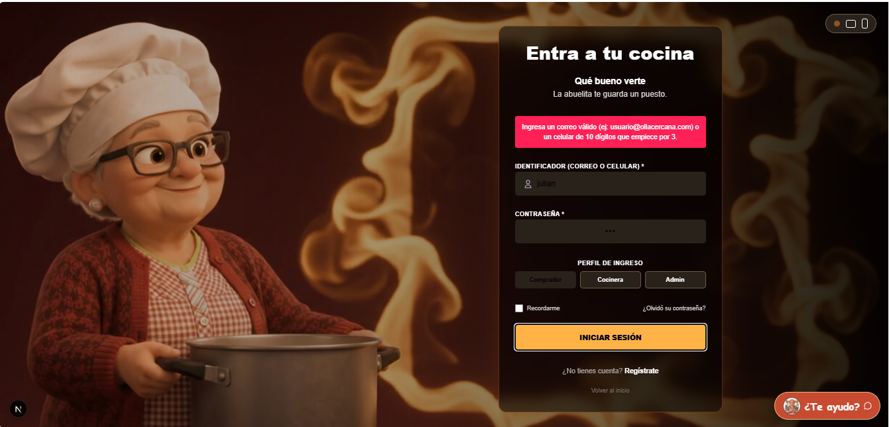

---

### 3.4 Menú de platos El Libretón

| Campo | Detalle |
|---|---|
| **Ruta** | `/menu` |
| **Rol que la ve** | Comprador (los visitantes pueden explorar) |
| **Responde a** | HU-06, HU-07, HU-08, HU-11, HU-14, HU-16 · FEAT-06 |

**Happy path.** Catálogo de platos caseros del día con filtros por categoría (Almuerzos, Sopas, Vegetariano, Postres), etiquetas dietéticas (Vegetariano, Sin Gluten, Sin Lactosa, Vegano) y distancia; búsqueda, «Antojo del Día», porciones disponibles sincronizadas y métodos de pago visibles. El comprador agrega platos a «Tu pedido». La pantalla abre con «Hoy se come rico», «Antojo del Día» y la abuelita («Ubica tu antojo» → *Ver mapa*); más abajo están las fichas de cada plato con precio por porción, distancia, conjunto, métodos de pago y los botones **Añadir** y **Reservar**, el panel **Tu pedido** (subtotal, entrega estimada y total con el botón «¡A comer!»), el banner del **Sello Olla Verde** y el acceso a **Vecino Fiel**. Al entrar al Libretón se muestra la animación del libro (se puede desactivar en Ajustes) y el menú también tiene modo oscuro.

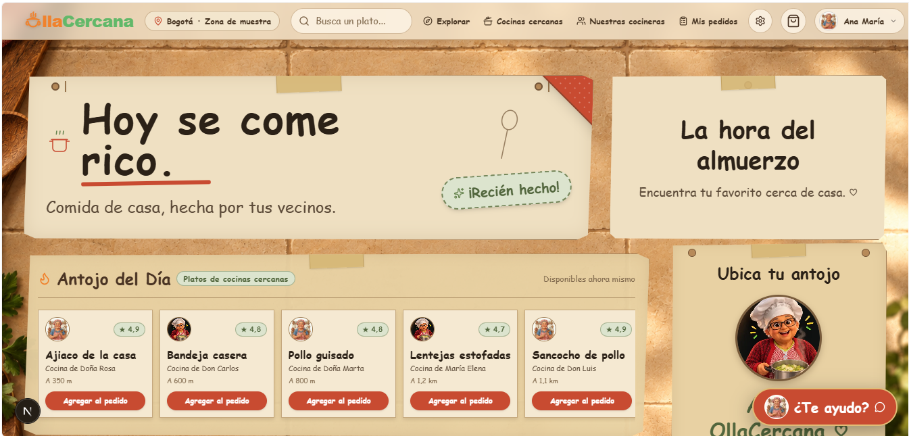

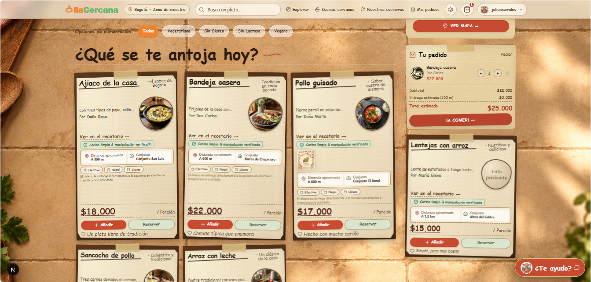

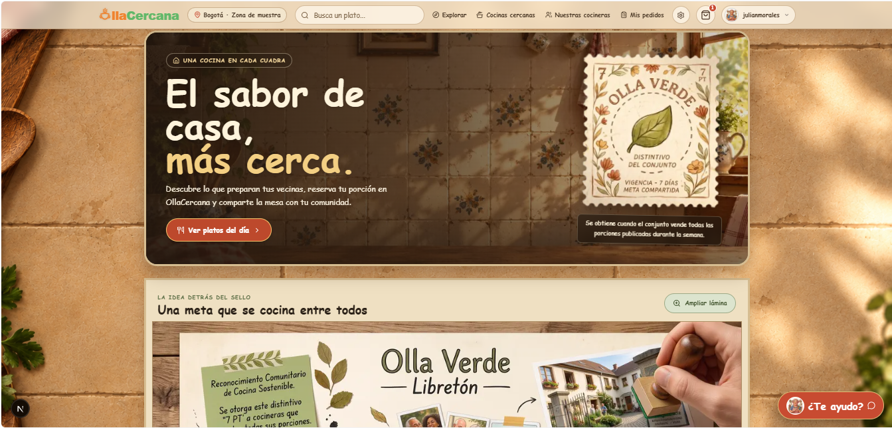

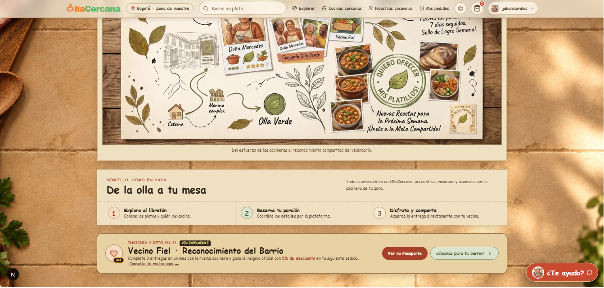

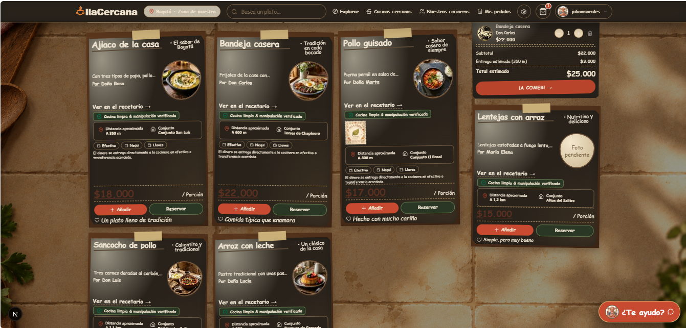

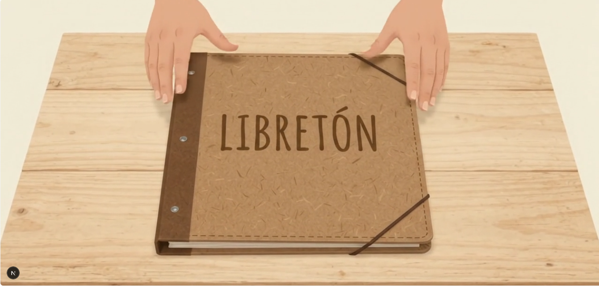

**Estado de error / vacío.** Búsqueda sin coincidencias: «No encontramos platos con esa búsqueda.». Pedido sin platos: «Tu pedido está vacío.». Si un visitante sin sesión intenta añadir o reservar aparece «Un momentico…» con opciones de iniciar sesión o crear cuenta (el equivalente en la ending page está en 3.2).

---

### 3.5 Mapa de cocineras cercanas

| Campo | Detalle |
|---|---|
| **Ruta** | `/cocineras-cercanas` |
| **Rol que la ve** | Comprador (público) |
| **Responde a** | HU-06, HU-09, HU-10 · FEAT-06 |

**Happy path.** Mapa ilustrado con anillos de 500 m y 1 km, pines seleccionables por cocinera y filtros Todas, 500 m, 1 km, 1.5 km, 2 km y Abiertas. La dirección exacta no se muestra; se comparte al confirmar la reserva. Debajo del plano, «Fogones activos en tu radio» lista cada cocina con su plato estrella, calificación, estado (Cocinando ahora / Cerrada hoy) y el botón «Ver plato y pedir en Libretón».

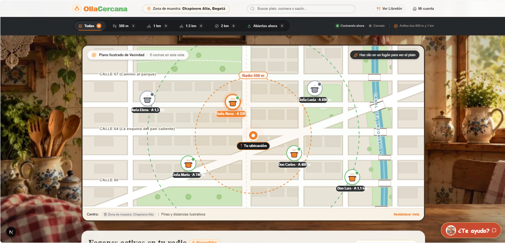

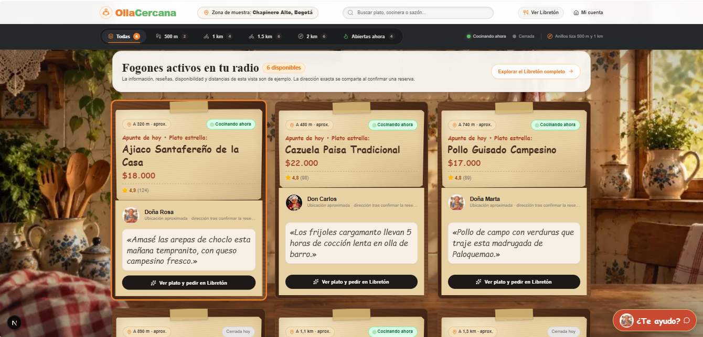

**Estado de error / vacío.** Sin resultados para el filtro: «No encontramos fogones con ese filtro», con sugerencia de ampliar el radio o ver todas las cocineras.

---

### 3.6 Directorio y perfil público de cocinera

| Campo | Detalle |
|---|---|
| **Ruta** | `/cocineras`, `/cocineras/[id]` |
| **Rol que la ve** | Comprador (público) |
| **Responde a** | HU-03, HU-22 · FEAT-08 |

**Happy path.** Directorio de vecinas cocineras con buscador. El perfil muestra la historia de la cocinera («La historia detrás del fogón»), sus platos («Lo que sale de su cocina») y su reputación con reseñas.

**Estado de error / vacío.** Búsqueda sin resultados: «Todavía no encontramos cocineras con ese nombre.». Perfil inexistente: «No encontramos este perfil». Reseñas filtradas por estrella sin datos: «No hay opiniones registradas para esta estrella.».

---

### 3.7 Reservar porción y confirmar pedido

| Campo | Detalle |
|---|---|
| **Ruta** | modal de reserva y `/pedido` |
| **Rol que la ve** | Comprador |
| **Responde a** | HU-05, HU-11, HU-12, HU-14 · FEAT-07 |

**Happy path.** El comprador elige porciones, método de pago (Efectivo, Nequi, Daviplata o Llaves; el pago no se procesa en la plataforma) y envía la solicitud. La reserva queda **pendiente** y expira a los **10 minutos** si la cocinera no responde. La pantalla «Revisa tu pedido» separa una solicitud por cocina, deja elegir el pago (Nequi, Llaves o Efectivo), muestra el total estimado y el botón «Enviar N solicitudes», e indica que OllaCercana no procesa pagos.

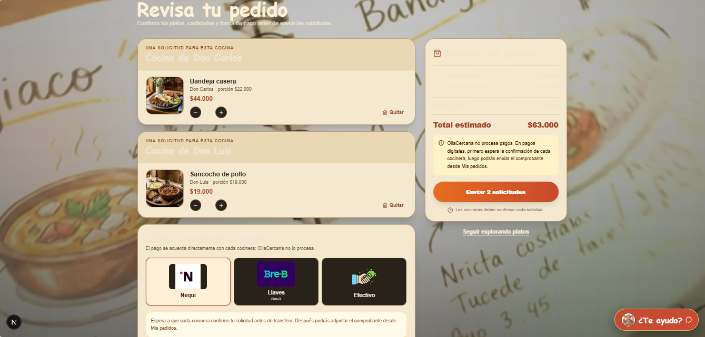

**Estado de error / vacío.** «Debes verificar tu número de celular antes de realizar una reserva», «Este plato ya no tiene porciones disponibles», «Solo hay N porción(es) disponible(s)», plato sin stock suficiente al enviar y «No se pudo guardar la solicitud. Inténtalo de nuevo.».

---

### 3.8 Mis pedidos y chat

| Campo | Detalle |
|---|---|
| **Ruta** | `/cuenta/reservas` |
| **Rol que la ve** | Comprador |
| **Responde a** | HU-11, HU-13, HU-15, HU-17, HU-18, HU-23 · FEAT-07, FEAT-11 |

**Happy path.** Lista de pedidos activos e historial con cuenta regresiva de la reserva, chat con la cocinera para coordinar la entrega, confirmación de entrega y pago, calificación del intercambio y reporte de la publicación o del usuario. Al completarse, el chat pasa a solo lectura. Cada reserva muestra su cuenta regresiva, el estado («En espera») y el avance: Solicitud enviada → Cocinera confirma → Adjunta comprobante → Preparación y entrega → Recibido, con el botón «Chat con cocinera»; a la derecha, el resumen de pedidos.

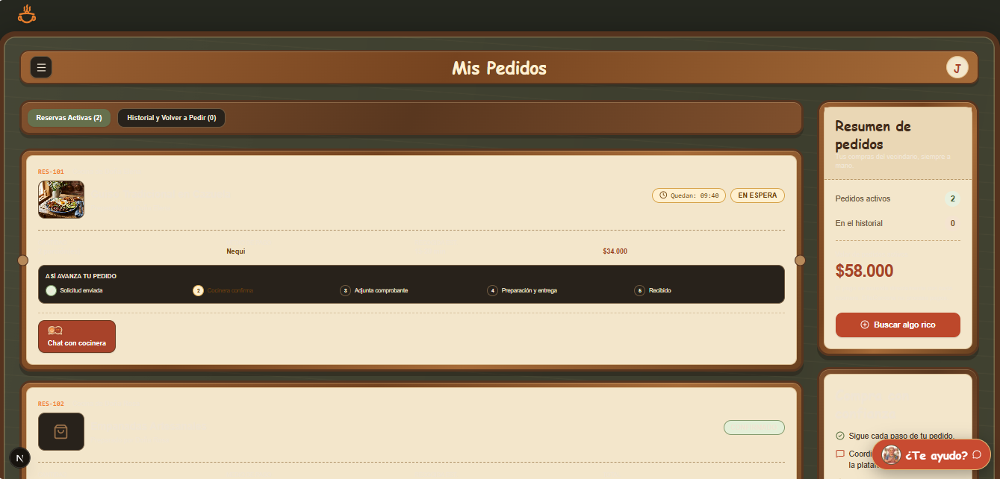

**Estado de error / vacío.** Sin pedidos: «No tienes pedidos activos» (pestaña activas) o «Tu historial está vacío». Comprobante de pago sin adjunto: «Adjunta una imagen o un archivo PDF.». Sesión vencida: redirige a Sesión expirada.

---

### 3.9 Calificar y reportar

| Campo | Detalle |
|---|---|
| **Ruta** | modales dentro de Mis pedidos |
| **Rol que la ve** | Comprador y cocinera |
| **Responde a** | HU-15, HU-18 · FEAT-08, FEAT-09 |

**Happy path.** Tras completarse la entrega, cada parte califica de 1 a 5 estrellas con comentario. Cualquier usuario puede reportar una publicación o usuario con motivo, explicación y evidencia en imagen.

**Estado de error / vacío.** Calificación: «Debe seleccionar al menos una estrella» y «Por favor escribir un comentario». Reporte: motivo sin elegir, explicación de menos de 10 caracteres, evidencia sin adjuntar o imagen de más de 900 KB.

---

### 3.10 Modo Cocinera

| Campo | Detalle |
|---|---|
| **Ruta** | `/cuenta/cocina` |
| **Rol que la ve** | Cocinera |
| **Responde a** | HU-04, HU-05, HU-12, HU-20, HU-23, HU-24 · FEAT-05, FEAT-07 |

**Happy path.** Panel para publicar platos con nombre, descripción, etiquetas, precio por porción, porciones y foto (máximo 3 publicaciones activas); aceptar o rechazar solicitudes con motivo, confirmar pago y entrega, actualizar porciones, pausar la cocina y ver historial de ventas e ingresos referenciales.

**Estado de error / vacío.** Publicar plato: nombre/descripción obligatorios (50 y 200 caracteres máx.), precio mayor a $0 y hasta $50.000, 1 a 20 porciones, foto JPG o PNG de hasta 5 MB y celular sin verificar. Conflicto de stock: «El plato fue modificado por otra reserva, refresca los datos.». Historial sin movimientos: «Aún no has registrado pedidos o reservas de porciones.».

---

### 3.11 Perfil

| Campo | Detalle |
|---|---|
| **Ruta** | `/cuenta/perfil` |
| **Rol que la ve** | Todos |
| **Responde a** | HU-03, HU-21 · FEAT-04 |

**Happy path.** Datos de la cuenta, perfil de cocina (nombre comercial, biografía, conjunto residencial y foto), verificación del celular con código y progreso de insignias. Muestra el «Pasaporte de Vecino Fiel» (HU-21) y el formulario de perfil y datos comerciales con medios de pago (Efectivo, Nequi, Llaves).

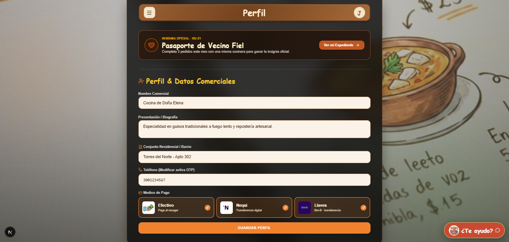

**Estado de error / vacío.** Código incompleto: «Ingresa el código completo de 6 dígitos.». Código errado: «Código incorrecto o expirado.».

---

### 3.12 Avisos

| Campo | Detalle |
|---|---|
| **Ruta** | `/cuenta/avisos` |
| **Rol que la ve** | Comprador, cocinera y admin |
| **Responde a** | HU-17 · FEAT-11 |

**Happy path.** Lista de novedades de reservas y mensajes de chat.

**Estado de error / vacío.** Sin novedades: «Todo tranquilo por aquí».

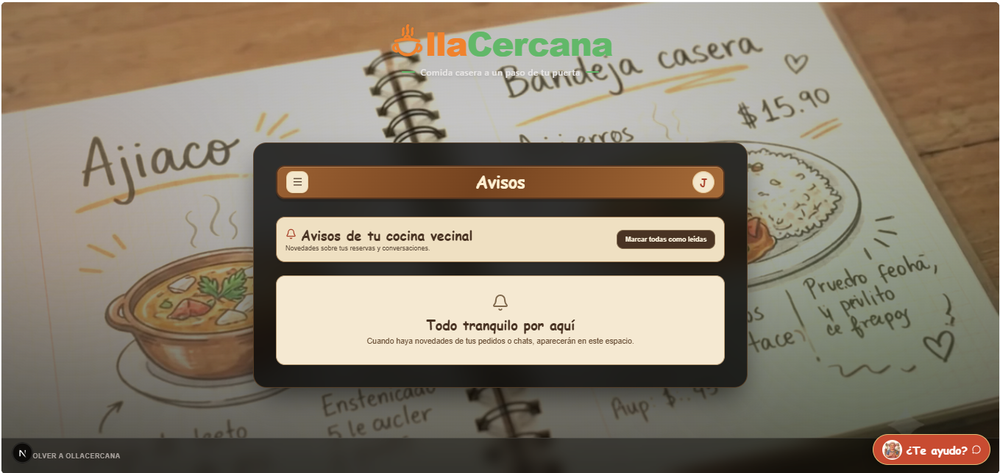

---

### 3.13 Vecino Fiel

| Campo | Detalle |
|---|---|
| **Ruta** | `/vecino-fiel` |
| **Rol que la ve** | Comprador |
| **Responde a** | HU-21 · FEAT-08 |

**Happy path.** Seguimiento de la racha: con 3 entregas en un mismo mes con la misma cocinera se otorga la insignia **Vecino Fiel** y 5 % de descuento en el siguiente pedido.

**Estado de error / vacío.** Racha en progreso: indica cuántas entregas faltan. Si pasa un mes sin pedidos, el contador se reinicia.

---

### 3.14 Panel de moderación

| Campo | Detalle |
|---|---|
| **Ruta** | `/cuenta/admin` |
| **Rol que la ve** | Administrador |
| **Responde a** | HU-19 · FEAT-09 |

**Happy path.** «Cuidado de la comunidad»: bandeja de reportes para revisar y resolver, y perfiles pausados por reactivar.

**Estado de error / vacío.** Sin reportes: «No hay reportes todavía…». Sin pausados: «No hay perfiles pausados por reactivar.». Sin permiso: «No tienes permiso para ver esta sección».

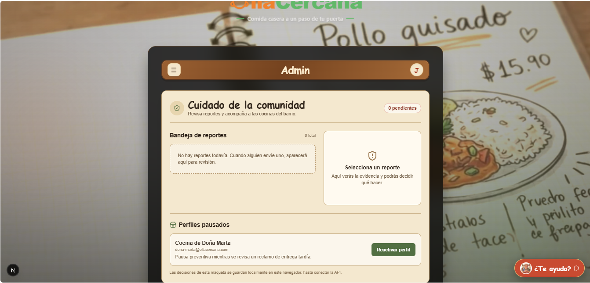

---

### 3.15 Sesión expirada y acceso denegado

| Campo | Detalle |
|---|---|
| **Ruta** | `/cuenta/sesion-expirada`, `/cuenta/acceso-denegado` |
| **Rol que la ve** | Todos |
| **Responde a** | HU-02 (seguridad de acceso) · FEAT-04 |

**Happy path.** Pantallas de estado: «La sesión se enfrió» (botón Iniciar sesión) y «Esta puerta no es para tu rol» (botón Cambiar de cuenta), ambas con acceso para volver al menú.

**Estado de error / vacío.** Estas dos pantallas son en sí los estados de error de sesión y de rol.

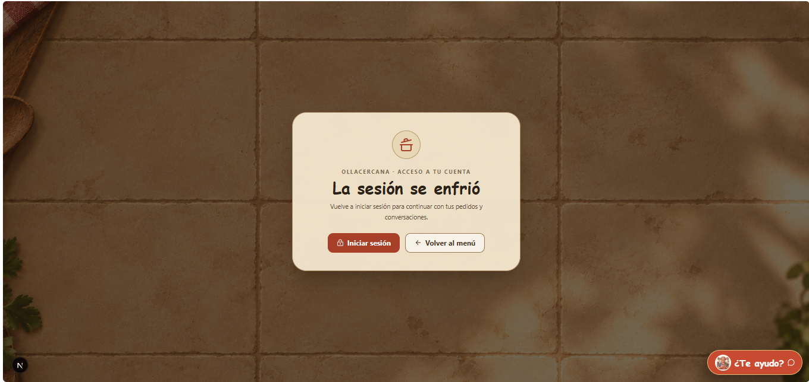

---

### 3.16 Ajustes y ayuda

| Campo | Detalle |
|---|---|
| **Ruta** | `/cuenta/ajustes`, `/ayuda` |
| **Rol que la ve** | Todos |
| **Responde a** | — (transversal) |

**Happy path.** **Ayuda de la Casa**: buscador por palabra clave (Sello Olla Verde, portería, Nequi, 10 minutos, cocinera…), caja para preguntarle directo a Doña Rosa (la abuelita) y respuestas sobre cuenta, pedidos, pagos y recogida. A ella se llega desde «Hablar con la Abuelita» o el botón flotante «¿Te ayudo?». **Ajustes** permite cambiar la apariencia de la interfaz. Incluye modo claro u oscuro, activar o quitar la transición de pasar la página, reducir animaciones y tamaño del texto (Estándar o Grande); las preferencias se guardan en el dispositivo.

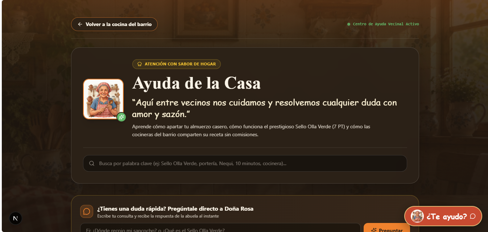

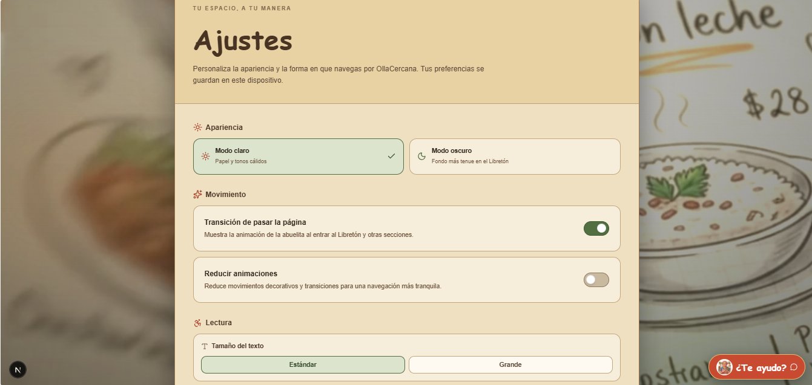

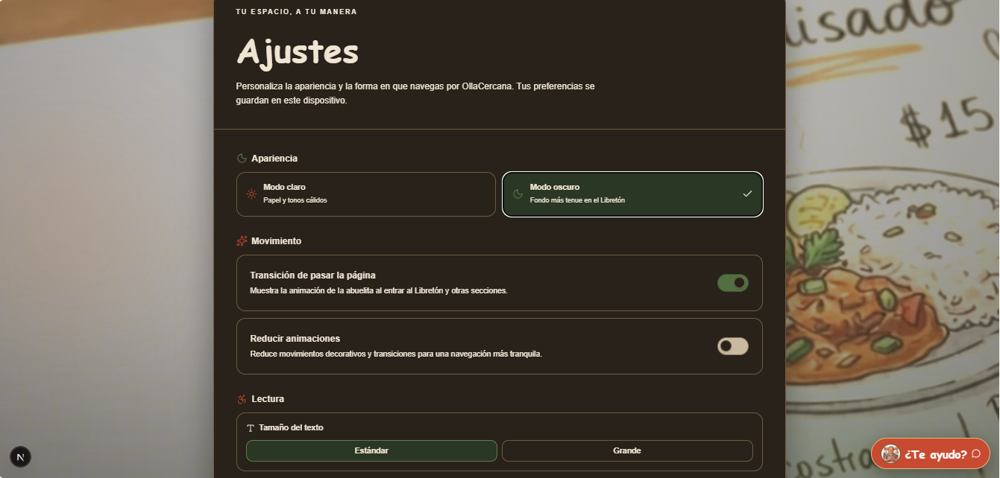

**Estado de error / vacío.** La ayuda aclara que la recuperación de contraseña por correo aún no está habilitada.

---

### 3.17 Página no encontrada (404)

| Campo | Detalle |
|---|---|
| **Ruta** | Cualquier ruta inexistente |
| **Rol que la ve** | Todos |
| **Responde a** | — (transversal) |

**Estado de error.** La abuelita avisa «¡Ay, qué pena! Esta página se nos perdió entre las recetas», con los botones **Volver al inicio**, **Ver el libretón** (Menú) y **Explorar cocinas cercanas** (Mapa).

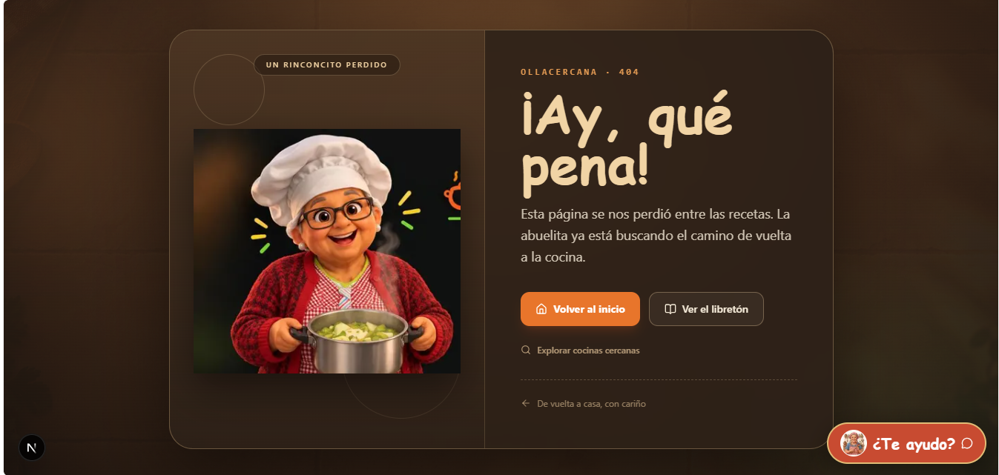

---

## 4. Manual de identidad

Resumen del Manual de Identidad OllaCercana **v3.0** (Oct. 2026). Marca hogareña: la calidez de la cocina del conjunto hecha sistema visual.

> **Eslogan:** "Comida casera a un paso de tu puerta."

**Contenido de esta sección**
- [4.1 Marca y voz](#41-marca-y-voz)
- [4.2 Logo](#42-logo)
- [4.3 Paleta de colores](#43-paleta-de-colores)
- [4.4 Tipografía](#44-tipografía)
- [4.5 Iconografía](#45-iconografía)
- [4.6 Componentes de interfaz](#46-componentes-de-interfaz)
- [4.7 Fotografía y personaje](#47-fotografía-y-personaje)

### 4.1 Marca y voz

- **Nombre:** *Olla* = cocina tradicional, fuego lento, calor del hogar. *Cercana* = proximidad hiperlocal y coordinación vecinal.
- **Valores:** Cercanía, Confianza, Sostenibilidad, Comunidad.
- **Público:** Cocineras (personas que cocinan en casa y ofrecen platos a su zona) y Compradores (vecinos que buscan comida casera cercana).
- **Voz:** directa y cálida (frases cortas, español cotidiano, ej. "apartar porción") y honesta (no prometer precios/disponibilidad garantizados, ni dirección exacta antes de confirmar la reserva, ni pagos procesados por la plataforma).

### 4.2 Logo

| Versión | Archivo |
|---|---|
| Principal (full color) | 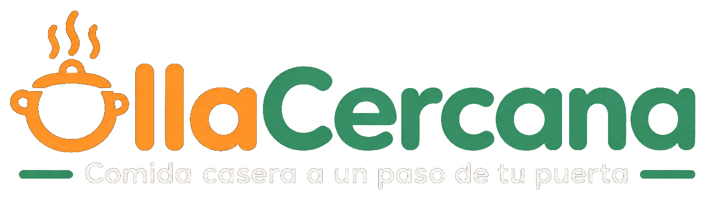 |
| Isotipo (la olla) |  |

- Variantes oficiales: principal, isotipo y monocromático (escala de grises); versiones para fondo claro y oscuro.
- **Área de reserva:** 1X = altura del isotipo de la olla. Ningún texto ni elemento ajeno debe invadirla.

| Contexto | Versión | Tamaño mínimo (referencia) |
|---|---|---|
| Digital | Horizontal completa | 32 px de alto |
| Digital | Solo isotipo / favicon | 24 px de alto |
| Impresión | Horizontal completa | 15 mm de alto |
| Impresión | Solo isotipo | 8 mm de alto |

**Usos incorrectos:** deformar el logo · colores fuera de paleta · sombras o degradados · reordenar isotipo y tipografía · bajo contraste con el fondo · separar la olla del nombre fuera de las variantes oficiales.

### 4.3 Paleta de colores

**Colores de marca**

| Nombre | Hex | Uso |
|---|---|---|
| Naranja Olla | `#F0822D` | Primario / CTA / selección |
| Verde Cercana | `#62B869` | Éxito / disponible |
| Amarillo Cálido | `#F4C430` | Confianza / calificación |
| Vino Abuela | `#901C21` | Personaje / hero |
| Madera Cálida | `#8B5E34` | Tarjetas / contornos |
| Terracota Buscar | `#C84B31` | Foco / acentos / acción |
| Púrpura Admin | `#A855F7` | Rol administrador |
| Error | `#E5484D` | Estados de error |

**Color por rol:** Comprador → verde `#62B869` · Cocinera → naranja `#F0822D` · Admin → púrpura `#A855F7`.

**Colores de interfaz**

| Grupo | Colores |
|---|---|
| Fondos y superficies | `#000000` global · `#17130F` nocturno · `#2A1E17` mapa · `#CBA679` Libretón · `#28221B` panel nocturno · `#3A3025` panel oscuro del menú · `#EFE0C2` papel · `#FAF6F0` crema · `#F5E9D2` cabecera menú · `#F7EDDB` ficha clara · `#DCE4CE` verde claro · `#46513B` verde oscuro |
| Texto y bordes | `#F4F3EF` texto claro · `#F0E5D3` texto claro tema oscuro · `#2C241E` texto mapa · `#2B2117` tinta · `#5B4A38` texto secundario · `#52663D` texto verde · `#AA8B5E` borde cálido · `#705A40` / `#715A3E` bordes oscuros · `#71805D` borde verde · `#F0E3CE` texto menú oscuro |
| Señales | `#448A9C` azul del mapa / agua |

**Equivalencias de impresión (orientativas)**

| Color | RGB | CMYK | Pantone |
|---|---|---|---|
| Naranja Olla | 240,130,45 | 0,58,90,0 | PMS 151 C |
| Verde Cercana | 98,184,105 | 64,0,76,0 | PMS 7488 C |
| Amarillo Cálido | 244,196,48 | 4,22,92,0 | PMS 123 C |
| Vino Abuela | 144,28,33 | 23,98,93,20 | PMS 188 C* |
| Madera Cálida | 139,94,52 | 35,56,87,22 | PMS 7567 C* |
| Terracota Buscar | 200,75,49 | 15,83,90,5 | PMS 7607 C* |
| Púrpura Admin | 168,85,247 | 48,73,0,0 | PMS 2587 C* |

**Accesibilidad (WCAG AA):** no usar texto blanco sobre Amarillo Cálido; el naranja `#F0822D` requiere texto oscuro en texto normal. Verificar el contraste de cada combinación antes de publicar.

### 4.4 Tipografía

| Uso | Fuente | Peso |
|---|---|---|
| Display / H1 (titulares editoriales) | Playfair Display | 700 |
| H2 / etiquetas, navegación | Outfit | 700 |
| Cuerpo y formularios | Outfit | 400 |
| Precios, nombres de platos, citas (acento manuscrito) | Caveat | 700 |

- Caveat no se usa en párrafos largos ni formularios.
- **Contingencia:** Playfair → Georgia/Merriweather · Outfit → Open Sans/Helvetica/Arial · Caveat → Outfit Italic (nunca Comic Sans ni Brush Script).
- Fuentes de Google Fonts: Playfair Display, Outfit, Caveat.

### 4.5 Iconografía

- Estilo lineal y cálido, cuadrícula **24×24 px**, trazo **2 px**, terminales y uniones redondeadas, un solo color según el estado del componente.
- Set base: Chat, Reserva, Pago, Calificación, Ubicación, Tiempo, Aviso, Perfil, Cocina.
- Pilares: Alimentación, Cercanía, Comunidad.

### 4.6 Componentes de interfaz

- **Tarjetas** estilo papel kraft (`#EFE0C2`) con borde `#D8C39C`; contorno madera `#8B5E34` en tarjetas destacadas.
- **Pizarra** (fondo `#26332A`, marco de madera) para listados de platos con precios en Caveat amarillo.
- **Chips:** Reservar (naranja), Disponible (verde), Calificación (amarillo), Error (borde rojo).
- **Inputs:** fondo `#FBF3E7`, borde `#D9B68C`, texto `#4A3222`, placeholder `#A88B6F`.
- **Filtros de proximidad:** Todas, 500 m, 1 km, 1.5 km, 2 km y Abiertas.
- **Mapa:** anillos de 500 m y 1 km, pines ilustrados; la dirección exacta no se muestra hasta confirmar la reserva.

### 4.7 Fotografía y personaje

- **Fotografía:** luz natural lateral y difusa; cenital 90° para bandejas y picado 45° para sopas/cazuelas; menaje tradicional (ollas de barro, cucharas de madera, paños). Nunca acabados de alta cocina ni luz de estudio.
- **Personaje "La abuela de la cuadra":** ilustración 3D simbólica (no es la foto de una cocinera real). Rasgos fijos: gorro de cocinera, gafas redondas, cardigan vino, camisa a cuadros rojo/blanco, corbata azul a rayas, aretes de perla, sosteniendo la olla. Úsala en portada, onboarding y botón de ayuda; no como foto de perfil ni en lugar de fotos reales de comida.


---

## 5. Estructura del repositorio

```
repo-front/
├── README.md
└── docs/
    ├── flujo/        → flujo-general.png
    ├── pantallas/    → capturas happy path y error/vacío
    └── identidad/    → logo, isotipo y personaje
```
